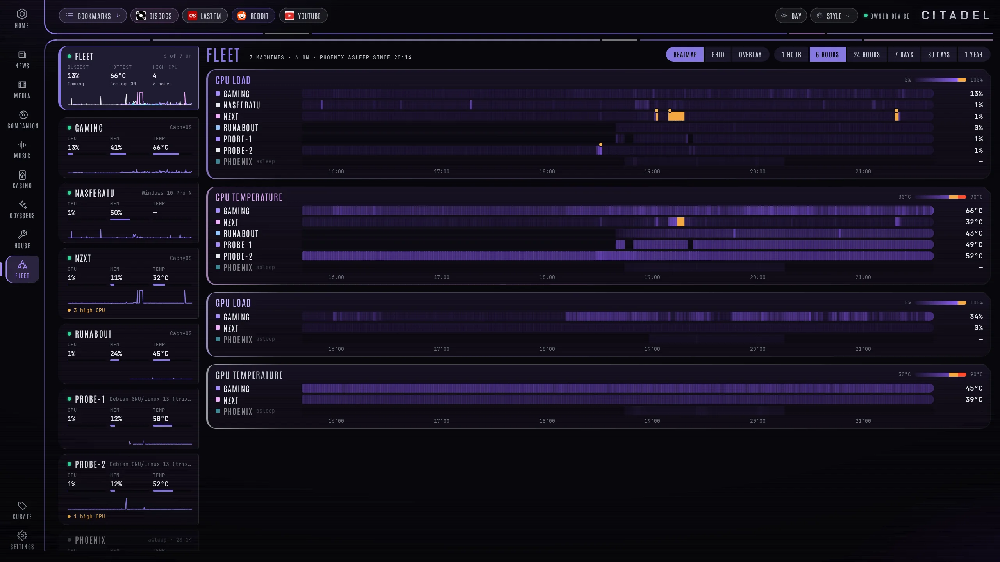

# Citadel

The service that runs my homelab. It starts and stops my other projects, monitors every machine in the house, keeps an eye on my backups and handles my life admin. I've connected a bunch of external APIs, mostly music services (ticketmaster, spotify, lastfm, musicbrainz, etc)

Have a look at the [online demo](https://www.mikehadfield.co.uk/demo/citadel/#home), a frozen, read-only copy with the personal bits taken out.

An overview of the devices currently connected to Citadel:


## What's in it

- **Home** - The central interactive dashboard
  - **Reminder strip** - Notifications and alerts
  - **Upcoming** - Google calendar integration, upcoming gigs, bin collections from the council website
  - **Remote Access** - one click opens a VNC viewer on any machine in the house
  - **Releases** - upcoming albums from my top artists, linked to my music companion project
  - **Vinyl radar** - pre-orders from labels and record shops, with prices compared across stores
  - **Gig radar** - upcoming shows near me for bands I actually listen to, via the ticketmaster API
  - **Services** - start and stop my other projects, with live uptime and detailed logging
  - **Launchpad** - quick links to everything on my network
  - **System** - live CPU, GPU, memory and disk space, with a warning before anything fills up
- **News** - my own news page that learns over time with up/down votes on stories
- **Media** - my Jellyfin media server
- **Companion** - my [Music Companion](https://mjhadfield.github.io/music-companion/) project
- **Music** - Music discovery and spotify playlist creation, links to a bunch of external services
- **Casino** - Casino World, a multiplayer casino sim I've built in GoDot
- **Odysseus** - Local AI LLM for simple tasks
- **House** - Home renovation tasks and projects
- **Fleet** - CPU, memory, temperatures and disk space monitoring with stats held for a year
- **Curate** - Music Maintenance, for tidying up the Music Companion SQL database
- **Audio** - my own GoXLR mixer: faders, routing, effects, sampler, microphone settings and lighting, from any device
- **Settings** - everything is editable in the browser: links, projects, news feeds, record shops, schedules, backups, etc. 

## Additional features

- **Themes** - the original Citadel or an LCARS take on it, each with light/dark mode, plus custom themes: pick four colours (Basic) and everything else follows, or set every colour yourself (Advanced). four ready-made LCARS variants come with it: COM (red), SCI (blue), ENG (gold) and ENT (silver)
- **TV mode** - pair a TV with a short code and it cycles through the panels I allow, with a slow pixel shift so nothing burns in
- **Guest page** - anyone else on the WiFi just gets the media server
- **Phone layout** - its own header and tabs, with swiping between pages
- **Android app** - a small WebView app for my phone
- **Wallpaper** - another PC keeps the Home screen open under its other windows as a live desktop; opened with `?wall`, it reloads itself when Citadel restarts
- **Backups** - nightly copies of the database, and a warning when the backup to my other PC hasn't run
- **Bookmarks** - the first four in the top bar, the rest in a drop-down

## How it works

Python ([FastAPI](https://fastapi.tiangolo.com/)) and plain HTML/JS with no build step. Everything I configure lives in one SQLite database.

It runs as a systemd user service on my PC. The projects it launches run as their own systemd units, so restarting Citadel doesn't kill anything.

There are no passwords. A device becomes an "owner" by opening a one-time link printed on the PC's terminal, which needs access to the PC itself. Everything else on the network only gets the guest page.

Everything syncs overnight, once a day, one job after another, so no one gets hammered. If something fails it backs off and tries again later rather than retrying straight away. Record shops are read once a day, and the ones that ask for a delay between requests in their robots.txt get it.

I learnt this one the hard way with Spotify. It doesn't publish its rate limits, and an over-eager Discover rebuild earned me a 19-hour ban. Every Spotify call now goes through one pacer, and when Spotify says wait, it waits.

## Can I run it?

You can, but it's built around my setup. The bins only work for Salford, the Music page reads my Music Companion database, and the addresses of the embedded pages are hard-coded. You're welcome to have a look and borrow bits.

If you want to try it (Linux with systemd, Python 3.11+):

```bash
cp .env.example .env      # Jellyfin address, bin UPRN and calendar link (optional)
deploy/install.sh         # venv, dependencies, systemd service and the `hub` command
hub enrol                 # prints a one-time link to make your device an owner
```

Then open `http://<your-pc>:8080`. For development:

```bash
python3 -m venv .venv && .venv/bin/pip install -r requirements-dev.txt
.venv/bin/python -m pytest
.venv/bin/python -m app   # runs on :8080
```

## Credits

Data from [MusicBrainz](https://musicbrainz.org/), the [Cover Art Archive](https://coverartarchive.org/), [Last.fm](https://www.last.fm/), [Setlist.fm](https://www.setlist.fm/), [Discogs](https://www.discogs.com/), [Ticketmaster](https://developer.ticketmaster.com/), [Spotify](https://developer.spotify.com/), [Jolpica](https://github.com/jolpica/jolpica-f1) (F1 calendar) and the RSS feeds of the news sites it reads. The bins parser follows the approach of [UKBinCollectionData](https://github.com/robbrad/UKBinCollectionData). Not affiliated with or endorsed by any of them.

Fonts: [Chakra Petch](https://fonts.google.com/specimen/Chakra+Petch) and [JetBrains Mono](https://www.jetbrains.com/lp/mono/), both under the SIL Open Font License.
